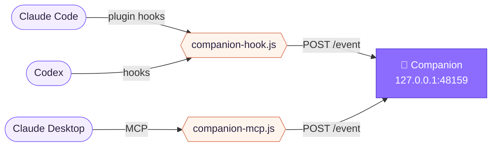

<div align="center">


# AI Companion

*A tiny dragon in the corner of your screen that keeps you company while your AI agent works.*


**English** · [Русский](README.ru.md)

</div>

<br>

It shows what your agent is up to — thinking, editing a file, waiting for you — and reads its answers back in a little speech bubble, mouth moving as it talks. There is nothing to type into: you keep chatting in the agent's own app, and the companion just keeps you posted.

<table>
<tr>
<td align="center" width="25%">💭<br><sub><b>thinking</b><br>it over</sub></td>
<td align="center" width="25%">🛠️<br><sub><b>working</b><br><code>Edit main.js</code></sub></td>
<td align="center" width="25%">✋<br><sub><b>waiting</b><br>for your OK</sub></td>
<td align="center" width="25%">💬<br><sub><b>speaking</b><br>the answer</sub></td>
</tr>
</table>

## Quick start

```bash
npm install
npm start
```

Then say hi:

```bash
npm run demo
```

> [!TIP]
> With the Claude Code plugin installed, type `/companion` to bring the dragon back whenever it is closed or hidden.

## Connect your agent

| | Agent | Setup | Shows |
|:-:|---|---|---|
| ✅ | **Claude Code** — CLI, Code tab, IDEs | plugin | every state + answers |
| ✅ | **Codex** — CLI, app, IDEs | hooks | every state + answers |
| 🟡 | **Claude Desktop** — Chat tab | MCP server | what the model chooses to share |
| ⏳ | **ChatGPT Desktop** | — | no hooks or local MCP yet |

<details>
<summary><b>Claude Code</b> · plugin</summary>
<br>

```bash
claude plugin marketplace add Quaximur/AICompanion
```

```bash
claude plugin install ai-companion@ai-companion
```

Turn it off and on with `claude plugin disable` / `enable ai-companion@ai-companion`, or from `/plugin`.

The plugin adds `/companion` and a **Start** button above the prompt while the companion isn't running. It finds the app through `%APPDATA%\ai-companion\launch.json`, which the app writes on every start. If it can't find it, launch the companion once by hand with `npm start`.

</details>

<details>
<summary><b>Codex</b> · hooks</summary>
<br>

```bash
npm run hooks:install
```

Adds hooks to `~/.codex/hooks.json`, keeps a `*.bak-companion` backup and leaves your own hooks alone. Restart Codex afterwards. `npm run hooks:uninstall` removes them.

</details>

<details>
<summary><b>Claude Desktop</b> · MCP server</summary>
<br>

Add to `%APPDATA%\Claude\claude_desktop_config.json`:

```json
{
  "mcpServers": {
    "companion": {
      "command": "node",
      "args": ["C:/path/to/AICompanion/mcp/companion-mcp.js"]
    }
  }
}
```

The model gets `companion_status` and `companion_say`. Ask for them in your project instructions, e.g. *"End every answer with companion_say and a one-line summary."*

</details>

> [!NOTE]
> If the companion isn't running, the hooks quietly give up within 0.8 s — your agent never waits on it.

## Living with it

| Do | To |
|---|---|
| <kbd>Drag</kbd> | move it anywhere |
| <kbd>Click</kbd> | a poke — hearts included ♥ |
| <kbd>Right-click</kbd> | menu: voice, size, pin in place, back to the corner |
| <kbd>Click</kbd> a bubble | show it all at once, click again to close |
| Tray icon | hide and show |

The interface speaks Russian for now.

## How it works



<details>
<summary><b>Event protocol</b> · drive it from anything</summary>
<br>

```bash
curl -X POST http://127.0.0.1:48159/event \
  -H "Content-Type: application/json" \
  -d '{"source":"my-tool","type":"status","state":"working","detail":"Build"}'
```

| Field | Values |
|---|---|
| `type` | `status` · `say` |
| `state` | `idle` · `thinking` · `working` · `waiting` · `done` · `error` |
| `text` | what to say; markdown is simplified, long text is cut to ~900 chars |

Requests carrying an `Origin` header (web pages) are turned away.

</details>

<details>
<summary><b>Your own character</b> · bring a sprite sheet</summary>
<br>

Drop a 4×4 sprite sheet with a transparent background into `assets/sheet.webp`, then:

```bash
npm run frames
```

Which frame is which — mouth closed, half open, wide, a wink — lives in `FRAME` and `MOUTH` at the top of `app/renderer/companion.js`.

</details>

<details>
<summary><b>Under the hood</b></summary>
<br>

- **Electron** — a transparent, always-on-top window that lets clicks through its empty space; dragging follows the system cursor, with the mouse button read from Windows via **koffi**
- **Plain HTML, CSS and JS** — sprite frames, state animations, a typewriter that shapes the mouth from the vowels it prints
- **Local HTTP** on `127.0.0.1:48159` — one door for every agent
- **Claude Code plugin** — hooks, the `/companion` command and the start button; tests run with `claude plugin test ./plugin`
- **Python + Pillow** — `tools/slice_sprites.py` slices and aligns the sprite sheet

</details>

<br>

<div align="center">
<sub>made with a lot of 💜 and a little dragon</sub>
</div>
