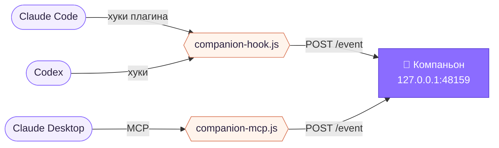

<div align="center">


# AI Companion

*Маленький дракончик в углу экрана, который составит вам компанию, пока работает ИИ-агент.*


[English](README.md) · **Русский**

</div>

<br>

Он показывает, чем занят агент — думает, правит файл, ждёт вас, — и пересказывает ответы в облачке, шевеля ртом. Печатать ему ничего не нужно: вы общаетесь с агентом в его привычном приложении, а компаньон просто держит вас в курсе.

<table>
<tr>
<td align="center" width="25%">💭<br><sub><b>думает</b><br>над задачей</sub></td>
<td align="center" width="25%">🛠️<br><sub><b>работает</b><br><code>Edit main.js</code></sub></td>
<td align="center" width="25%">✋<br><sub><b>ждёт</b><br>вашего «да»</sub></td>
<td align="center" width="25%">💬<br><sub><b>рассказывает</b><br>ответ</sub></td>
</tr>
</table>

## Быстрый старт

```bash
npm install
npm start
```

И поздоровайтесь:

```bash
npm run demo
```

> [!TIP]
> С плагином Claude Code достаточно набрать `/companion`, чтобы вернуть дракончика, если он закрыт или спрятан.

## Подключение агентов

| | Агент | Подключение | Что показывает |
|:-:|---|---|---|
| ✅ | **Claude Code** — CLI, вкладка Code, IDE | плагин | все режимы + ответы |
| ✅ | **Codex** — CLI, приложение, IDE | хуки | все режимы + ответы |
| 🟡 | **Claude Desktop** — вкладка Chat | MCP-сервер | то, чем модель решит поделиться |
| ⏳ | **ChatGPT Desktop** | — | пока нет хуков и локального MCP |

<details>
<summary><b>Claude Code</b> · плагин</summary>
<br>

```bash
claude plugin marketplace add Quaximur/AICompanion
```

```bash
claude plugin install ai-companion@ai-companion
```

Выключить и включить: `claude plugin disable` / `enable ai-companion@ai-companion` или через `/plugin`.

Плагин добавляет команду `/companion` и кнопку «Запустить» над полем ввода, пока компаньон не запущен. Приложение он находит по `%APPDATA%\ai-companion\launch.json`, который оно записывает при каждом запуске. Если не нашёл — запустите компаньона один раз вручную через `npm start`.

</details>

<details>
<summary><b>Codex</b> · хуки</summary>
<br>

```bash
npm run hooks:install
```

Дописывает хуки в `~/.codex/hooks.json`, сохраняет копию `*.bak-companion` и не трогает ваши собственные хуки. После установки перезапустите Codex. Убрать: `npm run hooks:uninstall`.

</details>

<details>
<summary><b>Claude Desktop</b> · MCP-сервер</summary>
<br>

Добавьте в `%APPDATA%\Claude\claude_desktop_config.json`:

```json
{
  "mcpServers": {
    "companion": {
      "command": "node",
      "args": ["C:/path/to/AICompanion/mcp/companion-mcp.js"]
    }
  }
}
```

Модель получит `companion_status` и `companion_say`. Попросите о них в инструкциях проекта, например: *«В конце каждого ответа вызывай companion_say с коротким резюме»*.

</details>

> [!NOTE]
> Если компаньон не запущен, хуки тихо сдаются за 0,8 с — агент его никогда не ждёт.

## В быту

| Что сделать | Что будет |
|---|---|
| <kbd>Перетащить</kbd> | переедет куда угодно |
| <kbd>Клик</kbd> | тык — с сердечками ♥ |
| <kbd>Правый клик</kbd> | меню: голос, размер, закрепить на месте, вернуть в угол |
| <kbd>Клик</kbd> по облачку | показать текст целиком, второй клик закрывает |
| Иконка в трее | спрятать и показать |

## Как это устроено



<details>
<summary><b>Протокол событий</b> · управляйте из чего угодно</summary>
<br>

```bash
curl -X POST http://127.0.0.1:48159/event \
  -H "Content-Type: application/json" \
  -d '{"source":"my-tool","type":"status","state":"working","detail":"Сборка"}'
```

| Поле | Значения |
|---|---|
| `type` | `status` · `say` |
| `state` | `idle` · `thinking` · `working` · `waiting` · `done` · `error` |
| `text` | что сказать; markdown упрощается, длинный текст обрезается до ~900 символов |

Запросы с заголовком `Origin` (то есть со страниц в браузере) отклоняются.

</details>

<details>
<summary><b>Свой персонаж</b> · принесите спрайт-лист</summary>
<br>

Положите спрайт-лист 4×4 на прозрачном фоне в `assets/sheet.webp` и выполните:

```bash
npm run frames
```

Какой кадр за что отвечает — рот закрыт, приоткрыт, открыт широко, подмигивание — задаётся в `FRAME` и `MOUTH` в начале `app/renderer/companion.js`.

</details>

<details>
<summary><b>Под капотом</b></summary>
<br>

- **Electron** — прозрачное окно поверх всех, пропускающее клики сквозь пустые места; перетаскивание следует за системным курсором, а кнопку мыши читает из Windows через **koffi**
- **HTML, CSS и JS без фреймворков** — кадры спрайтов, анимации режимов и печать текста, где форма рта подбирается по гласным
- **Локальный HTTP** на `127.0.0.1:48159` — одна дверь для всех агентов
- **Плагин Claude Code** — хуки, команда `/companion` и кнопка запуска; тесты: `claude plugin test ./plugin`
- **Python + Pillow** — `tools/slice_sprites.py` нарезает и выравнивает спрайт-лист

</details>

<br>

<div align="center">
<sub>сделано с большой 💜 и маленьким дракончиком</sub>
</div>
